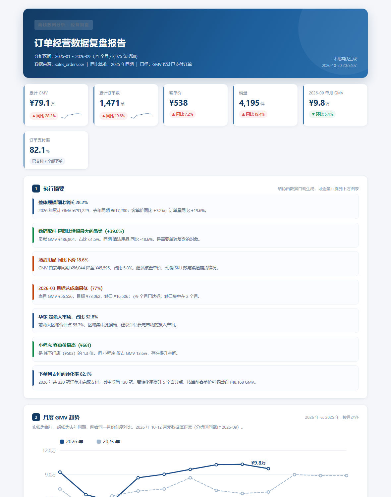

# offline-analytics-report

> 离线数据分析与报表 · 指标拆解 → 图表 → 自动结论 → 汇报级 HTML

面向「数据在本地，老板要看复盘」的场景：读入订单明细 CSV，产出一份**单文件、可打印、不依赖任何 JS 图表库**的 HTML 报表，外加一页可直接粘进方案/周报的 Markdown 结论摘要。

**全程离线运行，明细不出本机。**

**跑出来长这样**（真实运行产物截图，非示意图）：



👉 **[在线打开真 HTML 报表](https://mming-liu.github.io/offline-analytics-report/)** — 图表可 hover 看数值、可直接打印 PDF，与截图同源，由项目自身生成

---

## 零、操作步骤（照着敲，约 3 分钟）

> 命令按 **Windows cmd** 写。macOS / Linux 把 `python` 换成 `python3`，路径换成 `/你的路径/offline-analytics-report`。

### 步骤 1｜确认 Python 可用

```bat
python --version
```

期望 `Python 3.8` 及以上（实测 3.13.12）。提示找不到命令时改用 `py -3 --version`。

### 步骤 2｜进入项目目录

```bat
cd /d C:\myFloders\git\offline-analytics-report
```

必须在含 `analyze.py` 的目录下执行，否则报 `ModuleNotFoundError: No module named 'analytics'`。

### 步骤 3｜跑演示（自带 21 个月示例明细）

```bat
python analyze.py --demo
```

约 1 秒，输出：

```
[0/3] 已生成示例明细 3,975 行（2025-01 ~ 2026-09）
[1/3] 读取 sales_orders.csv：3,975 行 × 11 列
      分析区间 2025-01 ~ 2026-09，有效明细 3,975 条
      GMV ¥79.1万（同比 +28.2%），订单 1,471，客单价 ¥538
[2/3] 生成指标与图表
[3/3] 渲染 HTML 报表与摘要
```

### 步骤 4｜打开报表看结果

| 顺序 | 文件 | 能看到什么 |
| --- | --- | --- |
| ① | `out\report.html` | **建议先开这个**：KPI + 7 张图 + 执行摘要 + 目标达成 + 口径说明，单文件，断网可看，可直接 Ctrl+P 存 PDF |
| ② | `out\summary.md` | 纯文字结论摘要，可直接粘进周报、方案、邮件 |
| ③ | `out\metrics.json` | 全部指标的数字版，供二次加工或导入 BI |

打开方式：`start out\report.html`。

### 步骤 5｜跑自测

```bat
python -m unittest discover -s tests -v
```

期望结尾：

```
Ran 11 tests in 0.001s

OK
```

覆盖同比同月对齐、GMV 口径、ABC 跨线规则、SVG 图表输出、单一年份数据不崩溃。

### 步骤 6｜换成自己的数据

明细表放进 `data\`，或直接用绝对路径：

```bat
python analyze.py --input data\你的订单明细.csv --out out_2026Q3
```

**必需字段（缺一个会直接报错并提示缺哪个）**

| 字段 | 说明 |
| --- | --- |
| `order_date` | 订单日期，支持 `2026-07-05` / `2026/7/5` / `20260705` 等写法 |
| `amount` | 订单金额，纯数字（带 ¥ 或千分位的先过项目 2 清洗） |
| `status` | 订单状态，**必须含「已支付」这一取值**，否则 GMV 会算成 0 |

**可选字段（有就自动多拆一个维度，没有则归入「未标注」）**：`order_id`、`qty`、`region`、`channel`、`category`、`customer_id`。

### 步骤 7｜改口径的四个位置

| 想改什么 | 怎么改 |
| --- | --- |
| 同比基准年 | `python analyze.py --input 明细.csv --year 2025` |
| 目标系数（默认去年同月 × 1.15） | `analytics/metrics.py` 顶部 `TARGET_FACTOR = 1.15`，改一处即可，报表与摘要文字会同步 |
| 增加拆解维度 | `metrics.py` 里仿照 `by_dimension("region")` 加一行 |
| 配色 / 标题 / Logo | `analytics/report.py` 顶部模板与 `charts.py` 的颜色常量 |

### 步骤 8｜出问题先查这张表

| 现象 | 原因 | 处理 |
| --- | --- | --- |
| `缺少必需字段：amount` | 列名不是约定的英文名 | 改表头，或先在项目 2 里把列名映射成约定名 |
| GMV 显示 ¥0 | `status` 里没有「已支付」这个值 | 把客户的状态取值映射成「已支付」，或在 `metrics.py` 里改判定条件 |
| 同比显示「—」或提示「无同期数据」 | 数据只有一年，没有去年同期 | 属正常表现（已做兼容，不会崩）；要同比就补上一年数据，或改用 `--year` 指定有同期的年份 |
| 图表不显示 / 打印空白 | 用了不支持的旧浏览器内核 | 用 Edge / Chrome 打开；图表是内联 SVG，不需要 JavaScript |
| `ModuleNotFoundError: No module named 'analytics'` | 不在项目根目录执行 | 先 `cd /d` 到含 `analyze.py` 的目录 |

## 一、产物说明（跑完你会看到什么）

自动生成 21 个月、约 4,000 条订单明细，输出到 `out/`：

| 文件 | 说明 |
| --- | --- |
| `report.html` | 汇报级报表：KPI + 7 张图 + 自动结论 + 口径说明 |
| `summary.md` | 纯文字结论摘要（核心指标表、结论、明细表、口径），可直接粘贴 |
| `metrics.json` | 机器可读的全部指标，供二次加工或进 BI |

## 二、报表里有什么

| 模块 | 内容 |
| --- | --- |
| 执行摘要 | 5-7 条由数据自动生成的结论，每条都可回溯到具体图表 |
| KPI 区 | 累计 GMV、订单数、客单价、销量、最近月环比、支付率，均带同比徽章与迷你趋势线 |
| 月度趋势 | 当年 vs 去年**按月对齐**的双折线 |
| 品类结构 | 占比环形图 + 明细表（GMV / 占比 / 订单 / 客单价 / 同比 / ABC 等级） |
| 品类贡献 | 帕累托图（柱 + 累计折线 + 80% 分界线） |
| 区域 / 渠道 | GMV 条形图 + 客单价对比表 |
| 转化漏斗 | 下单 → 有效 → 支付，含逐层与累计转化率 |
| 目标达成 | 月度进度条（默认目标 = 去年同月 × 1.15，可改） |
| 口径说明 | 每个指标的定义都写在报告里，避免对不上账 |

## 三、几个容易踩的坑（脚本已规避）

1. **同比必须同月对齐**：分析区间是 2026 年 1-9 月时，去年同期只取 1-9 月。拿 9 个月和 12 个月比，会得出「同比下滑」的假结论 —— 报表内建了这个校验。
2. **GMV 口径先说清**：默认只计「已支付」，取消、退款、待支付都不算；订单数按 `order_id` 去重。口径写在报告第 11 节。
3. **ABC 用跨线规则**：把自己累计进 70% 之内的品类归为 A 类。否则单一品类占比 90% 时会被误判为 C。
4. **图表离线可用**：全部图表为内联 SVG（含 hover 数值），不用 ECharts/Chart.js，断网、内网环境、打印 PDF 都不退化。

## 四、定制方式

| 需求 | 做法 |
| --- | --- |
| 换自己的数据 | `python analyze.py --input 你的明细.csv`（需含 order_date / amount / status，其余维度列可选） |
| 改同比年份 | `--year 2025` |
| 改目标系数 | `analytics/metrics.py` 顶部 `TARGET_FACTOR`（默认 1.15） |
| 加维度拆解 | 在 `analyze()` 的 `by_dimension("字段名")` 加一行 |
| 改周期复跑 | 配 Windows 计划任务每月 1 号执行，产出按月份归档 |

## 五、与其他两个 demo 的关系（能力链）

```
py-automation-kit          data-clean-pipeline           offline-analytics-report
接口同步/批量整理  ──→      脏数据 → 标准数据集      ──→   标准数据集 → 经营复盘报表
```

三个项目字段口径统一（同一套订单字段），清洗产物 `clean_dataset.csv` 可以直接喂给本工具：

```bash
python analyze.py --input ../data-clean-pipeline/out/clean_dataset.csv
```

## 六、目录结构

```
offline-analytics-report/
├── analyze.py                # CLI 入口
├── analytics/
│   ├── metrics.py            # 指标计算（KPI/同比/维度拆解/ABC/漏斗/目标/自动结论）
│   ├── charts.py             # 纯 SVG 图表：折线/条形/环形/帕累托/漏斗/迷你趋势线
│   └── report.py             # HTML 渲染
├── demo/make_sales_data.py   # 示例数据（埋了 3 月缺货、新品放量等业务故事线）
├── tests/test_metrics.py     # 11 条测试（同比对齐、GMV 口径、ABC 规则、图表输出）
├── data/                     # 输入明细
└── out/                      # 报表产物
```

## 七、环境要求

- Python 3.8+（实测 3.13），**零第三方依赖**，可完全断网运行
- 输入支持 UTF-8（含 BOM）与 GBK 编码 CSV

## 八、边界说明

- 本 demo 的自动结论基于通用规则（最大增幅、最大下滑、最低达成等），不含行业先验知识；垂类结论需要结合客户业务补充。
- 报表默认浅色打印友好风格；如需对接客户 PPT 模板（配色、Logo、字体），可按需定制模板。
- 数据量大时（百万行级）建议先在项目 2 完成预聚合，或提供 pandas 增强版。

---

## 九、同系列仓库（可串成一条链路）

| 仓库 | 作用 |
| --- | --- |
| [py-automation-kit](https://github.com/mming-liu/py-automation-kit) | 文件与接口层：批量整理、多表合并、接口同步，产出规范 CSV |
| [data-clean-pipeline](https://github.com/mming-liu/data-clean-pipeline) | 数据层：脏表 → 标准数据集，逐格留痕可追溯 |
| **offline-analytics-report**（本仓库） | 报表层：标准数据集 → 经营复盘报表与结论 |

**汇总演示页（一页看全三个项目）**：https://mming-liu.github.io/bid-demo-overview/ —— 三张实拍截图、硬指标、服务编号对照与现场验证命令。

---

维护：需求分析师 + 测试与开发工程师 轻量化协作 · 口径前置对齐，结论可回溯
